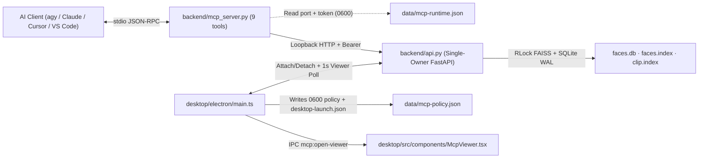

# SnapSort MCP Architecture & Reference

Local, offline-first Model Context Protocol (MCP) architecture for SnapSort. All ML inference (CLIP, YuNet, SFace), SQLite, and FAISS stay on-device.

---

## 1. MCP Setup Options Considered

| Setup Option | How It Works | Pros | Cons | Verdict |
| --- | --- | --- | --- | --- |
| **`stdio` Thin Proxy → Single-Owner Backend** | AI client spawns lightweight `mcp_server.py` over `stdio`; it proxies authenticated loopback HTTP to one FastAPI `api.py` per `data_dir`. | Works with dynamic Electron ports; single FAISS/SQLite writer; shared ML RAM; supports headless auto-start; universal client support. | Extra thin Python proxy process (negligible RAM/CPU). | **Selected** |
| **Streamable HTTP on FastAPI** | AI client connects directly to FastAPI HTTP endpoint. | No adapter script. | Breaks static configs on dynamic port; exposed to local browser/CSRF surfaces; cannot auto-start when desktop app is closed. | Deferred |
| **Legacy HTTP + SSE** | Persistent SSE stream directly to FastAPI. | Supported by older clients. | Deprecated in MCP spec; same port/CSRF/auto-start issues plus long-lived connections. | Rejected |
| **Direct-Disk `stdio` (No Backend)** | `mcp_server.py` opens SQLite/FAISS and loads ONNX directly. | Single hop. | Corrupts FAISS/SQLite on concurrent desktop/headless writes; duplicates 1–2 GB ML RAM per client. | Rejected |

---

## 2. Why We Chose `stdio` Proxy → Single-Owner Backend

1. **Dynamic port compatibility:** Electron picks a free loopback port on launch; the proxy discovers it via `data/mcp-runtime.json` without rewriting client configs.
2. **Zero FAISS/SQLite corruption:** Only one `Controller` owns `faces.db`, `faces.index`, and `clip.index` per `data_dir`, enforced by OS file locks (`startup.lock` + `backend.lock`).
3. **Single ML memory footprint:** Multiple AI clients share one backend instead of loading separate ONNX models.
4. **Seamless desktop + headless operation:** Works whether SnapSort is open or closed (when headless access is enabled), with live attach/detach handoff.
5. **Broad local client compatibility:** Standard `stdio` works out-of-the-box with Antigravity (`agy`), Antigravity IDE, Claude Desktop, Cursor, Claude Code, and VS Code.

---

## 3. Core Design Decisions

1. **Process ownership:** The AI client owns `mcp_server.py` (stays alive even when SnapSort is closed); `api.py` is a single-owner service per `data_dir` that auto-exits when detached and idle (`--idle-timeout 300`).
2. **Detached headless spawning:** `mcp_server.py` spawns headless `api.py` detached with `stdin`/`stdout` redirected to `DEVNULL` and `stderr` to `data/backend.log`, preventing `stdio` JSON-RPC corruption, and reaps exited children via a daemon thread (zero zombies).
3. **Lazy resources & throttling:** `CLIPProcessor` and `multiprocessing.Pool` initialize lazily; idle worker pools shut down; headless scans cap workers, run at lower OS priority, and enforce `max_headless_scan_images`.
4. **Concurrency & crash safety:** `threading.RLock` guards FAISS; saves use temp + `fsync` + `os.replace()`; SQLite runs in WAL mode; `face_merges` redirect table prevents merged cluster resurrection; `Controller` backfills missing `clip_status` embeddings automatically.
5. **1-call orientation (`get_library_overview`):** Replaced 3 separate discovery tools (`list_people`, `list_approved_folders`, `get_library_stats`) with one tool returning stats, approved folders + `action_required`, people, and preview/scan capabilities.
6. **Verbatim natural search & zero internal leaks:** Removed `"a photo of ..."` query rewriting; `search_images` embeds the user's exact query, echoes `"query"` first, defaults to `top_k=5` (max `20`) with `offset`/`has_more`, and strips internal DB/ML fields (`min_score_used`, `clip_indexed_photos`, `highest_below_threshold`, `resolved_person_id`).
7. **Two-option preview architecture:**
   - **Option 1 (Private default):** `open_in_viewer` displays matches in SnapSort's minimal `McpViewer` overlay on-screen without sending image pixels to the AI (optional `launch_app` if SnapSort is closed).
   - **Option 2 (Opt-in AI inspection):** `get_image_preview` requires explicit in-chat user confirmation (`user_confirmed_preview: true`), `allow_previews: true` in Settings, and a strict per-minute cap (`max_preview_images`, default `5`, range `1–10`).
8. **UI-only immutable policy:** `<data_dir>/mcp-policy.json` (`0600`) is written only by SnapSort Settings; MCP exposes zero tools or HTTP routes to modify policy or approved roots.

---

## 4. Final MCP Product Overview

### Exposed MCP Tools (9 Total)

| Tool | Purpose | Key Constraints |
| --- | --- | --- |
| `get_library_overview` | Stats, approved folders (`action_required`), named people, and capabilities in 1 call. | `people_limit <= 50` |
| `search_images` | Verbatim natural semantic search (`query` echoed first) with optional `person_name`/`person_id`/`folder`. | `top_k` default `5` (max `20`), `offset` pagination, no internal DB fields |
| `get_person_images` | Paginated indexed photos containing a person cluster ID (resolves merges). | `limit` default `5` (max `20`), `offset` |
| `get_image_faces` | Face clusters and names in an indexed image. | Indexed paths only (`404` otherwise) |
| `list_folder_images` | Paginated indexed photos in an approved folder + empty/unindexed guidance. | Approved roots only; `limit` default `5` (max `20`) |
| `scan_folder` | Index new, modified, or CLIP-unindexed photos in an approved folder. | Requires `allow_agent_scan: true`; `wait_seconds <= 30` |
| `get_scan_progress` | Poll active/completed scan job status. | Read-only |
| `open_in_viewer` | **Option 1 (Private):** Show 1–20 indexed photos in SnapSort's minimal viewer. | Requires `allow_viewer_open: true`; `launch_app` requires `allow_launch_desktop: true` |
| `get_image_preview` | **Option 2 (AI access):** Downscaled EXIF-stripped JPEG preview. | Requires `user_confirmed_preview: true` + `allow_previews: true` + `max_preview_images` cap |

---

## 5. Features Summary

- **1-call library orientation** (`get_library_overview`) + empty/missing approved-folder guidance (`action_required`).
- **Natural verbatim search** (`"Chandler in blue shirt"`) with automatic person-name reranking, `top_k` pagination (`offset` / `has_more`), and zero internal DB exposure.
- **Minimal SnapSort viewer (`McpViewer`)** with keyboard navigation (`Esc`, `←`, `→`), thumbnail strip, and optional cold-launch via `desktop-launch.json`.
- **Two-option Settings UX** (`Preview & Viewing Options`): private viewer toggles + capped AI image inspection (`1–10` images/min).
- **1-click Quick Connect** in Settings for Antigravity (`agy`), Antigravity IDE, Claude Desktop, Cursor, Claude Code, and VS Code (with `.snapsort.bak` config backup), plus manual JSON copy, audit log viewer, and instant revoke/kill switch.

---

## 6. Security & Privacy Verification Audit

Directly verified against the current codebase:

1. **Image-byte exit audit (only 1 path):** Across all 9 MCP tools in `backend/mcp_server.py`, **only** `get_image_preview` (`L595-L619`) returns `{"type": "image", ...}`. `open_in_viewer` returns JSON paths/status only and displays images strictly inside the local Electron window.
2. **Dual preview gate & hard vs. soft boundaries:**
   - **Hard server-side enforcement (cannot be bypassed by any agent):** `allow_previews: false` in `mcp-policy.json` blocks previews in both `backend/mcp_server.py:603` and `backend/api.py:1276` (`HTTP 403`). Even when enabled, `backend/api.py:1273-1305` enforces `_resolve_indexed_path`, `approved_roots` containment (`os.path.realpath` + `commonpath`), EXIF/GPS stripping (`generate_preview`, `L974-L990`), `<= 1024px` downscaling, and a rolling 60s `max_preview_images` cap (`HTTP 429`).
   - **In-chat consent gate:** `user_confirmed_preview: true` (`mcp_server.py:596`) prevents accidental preview fetches before asking the user; `SERVER_INSTRUCTIONS` (`L257-L275`) also forbids local file-reading/vision tools on returned paths.
   - **Recommended setting:** Keep `allow_previews: false` in Settings and use Option 1 (`open_in_viewer`) for a hard server-side guarantee that zero image bytes ever reach an AI client; enable `allow_previews` only when you want bounded AI visual inspection.
3. **Network & auth hardening:** Loopback-only (`127.0.0.1`), `Host` header allowlist (`403`), constant-time 256-bit `Authorization: Bearer` on all `/api/*` and `/media/*` routes (`api.py:204-228`), strict loopback/Electron CORS, and `webRequest.onBeforeSendHeaders` in Electron (no tokens in URLs).
4. **Filesystem & policy integrity:** `0600` owner-only permissions on `mcp-policy.json`, `mcp-runtime.json`, `desktop-launch.json`, and `mcp-audit.log` (`mcp_runtime.py:70-89`); symlink/traversal/sibling-prefix blocking (`mcp_runtime.py:202-216`); zero policy-mutation or destructive tools; rotated audit log + instant `POST /api/mcp/revoke` kill switch (`api.py:1314`).

---

## 7. Codebase Changes Reference (Files & Symbols — No Inline Code)

### Backend Core & ML
- `backend/mcp_runtime.py` — Policy schema & normalization (`DEFAULT_POLICY` L31, `normalize_policy` L158), atomic `0600` JSON I/O (`write_json_atomic_private` L70), `desktop-launch.json` helpers, path containment (`is_path_within_approved_roots` L202), rotated audit log (`append_audit_log` L219), OS locking (`file_lock` L313).
- `backend/api.py` — Auth/Host/CORS middleware (`security_middleware` L204), attach/detach/heartbeat lifecycle, clean verbatim paginated search (`search_images` L820), indexed path + EXIF-stripped previews (`_resolve_indexed_path` L950, `generate_preview` L974), policy gate (`_require_mcp_policy` L1017), 1-call overview (`mcp_overview` L1109), viewer queue (`mcp_open_viewer` L1226, `consume_pending_viewer_request` L1265), capped previews (`mcp_preview` L1273), and kill switch (`mcp_revoke` L1314).
- `backend/search_engine.py` — Verbatim `_embed_query` (L88) and paginated pre-filtered `search_with_diagnostics` (L93).
- `backend/controller.py` — Serialized scan queue + CLIP backfill (`enqueue_scan` L133), end-of-scan saves (`_process_result` L328), lazy CLIP/pool teardown, and paginated search wrapper (`search_with_diagnostics` L447).
- `backend/db.py` — SQLite WAL mode, `face_merges` redirects (`resolve_face_id` L102, `merge_faces` L508), distinct face counts (`get_all_faces_with_counts` L268), and CLIP backfill query (`get_clip_indexed_image_ids` L425).
- `backend/indexer.py` & `backend/clip_index.py` — `threading.RLock`, `search_subset`, and atomic temp+`fsync`+`os.replace()` saves.
- `backend/clip_processor.py` & `backend/worker.py` — Thread-safe `AutoTokenizer` + `RLock`, and throttled low-priority headless worker mode.

### MCP Adapter
- `backend/mcp_server.py` — Zero-dependency `stdio` JSON-RPC server: headless spawn/reaper (`_spawn_headless_backend` L117, `_ensure_backend` L185), `SERVER_INSTRUCTIONS` (L257), 9-tool `TOOLS_SCHEMA` (L292), detached desktop launcher (`_launch_desktop_app` L444), tool dispatcher & dual preview gate (`_execute_tool` L491).

### Desktop (Electron + React)
- `desktop/electron/main.ts` — Headless attach/detach (`tryAttachExistingBackend` L256, `detachOrStopBackend` L363), bearer header injection (`webRequest.onBeforeSendHeaders` L540), `desktop-launch.json` writer (`writeDesktopLaunchMetadata` L556), 1s viewer queue poller (`pollViewerRequest` L566), and MCP policy/client/revoke IPC handlers (`mcp:savePolicy` L606, `mcp:stopHeadless` L673).
- `desktop/electron/mcpClients.ts` — Auto-detection, backup, atomic connect/disconnect for Antigravity (`agy`), Antigravity IDE, Claude Desktop, Cursor, Claude Code, and VS Code (`detectMcpClients` L211, `connectMcpClient` L243, `disconnectMcpClient` L284).
- `desktop/electron/preload.ts` & `desktop/src/electron.d.ts` — Typed IPC bridge for policy, clients, audit log, and `onMcpOpenViewer`/`consumePendingMcpViewer`.
- `desktop/src/components/McpViewer.tsx` — Minimal distraction-free overlay (`McpViewer` L7) with `Esc`/arrow navigation and thumbnail strip.
- `desktop/src/components/Settings.tsx` — MCP toggles, two-option `Preview & Viewing Options` (L236), Approved Folders, `Quick Connect AI Clients` (L345), manual JSON copy, audit activity, and revoke button.
- `desktop/src/store.ts`, `desktop/src/App.tsx`, `desktop/src/api.ts` — `mcpViewerSession` state, IPC listener/cold-launch consumer, and bearer-authenticated Axios setup.

### Tests, Runner & Docs
- `scripts/run_mcp_tests.py` — Reusable test runner (`--fast`, `--stress`, `--all`).
- `backend/tests/mcp_test_helpers.py` — Shared `StdioMcpClient`, stub CLIP processor, JPEG/EXIF/GPS fixture generators.
- `backend/tests/test_mcp_e2e.py` — Unit, API, pagination, overview, viewer open, and headless `stdio` E2E tests.
- `backend/tests/test_mcp_security.py` — Auth/Host/CORS, `0600` perms, path/symlink escape, EXIF stripping, `max_preview_images` cap, dual preview consent, viewer security gates, and revoke tests.
- `backend/tests/test_mcp_race_conditions.py` — Thundering herd, dual-backend lock, live search-during-scan, scan dedupe/queue, face-merge redirect, attach/detach, and port-change reconnect tests.
- `backend/tests/test_mcp_stress.py` — 4-client 100-call burst, 63-image persistence/restart, corrupt-file isolation, `mtime` re-index, headless budget cap, idle auto-shutdown, crash watchdog, and JSON-RPC hygiene tests.
- `desktop/tests/mcpClients.test.mjs` — Node test suite for Quick Connect config generation, symlink preservation, backups, and `agy mcp list` compatibility.
- `docs/mcp-support.md` — Repository MCP architecture and reference guide.

---

## 8. Testing & Verification Steps

1. **Fast regression suite (~50s):**
   `.venv/bin/python scripts/run_mcp_tests.py --fast`
   Runs E2E, security/privacy, and race-condition suites.
2. **Full verification (~85s — latest result: `36/36` Python, `5/5` Desktop, `tsc`, `oxlint` passed):**
   `.venv/bin/python scripts/run_mcp_tests.py --all`
   Adds 63-image batch, 4-client parallel burst, corrupt-file isolation, idle auto-shutdown, desktop `mcpClients.test.mjs`, TypeScript strict check, and Oxlint.
3. **Desktop production build:**
   `cd desktop && npx tsc --noEmit && npm run build`
4. **Manual smoke test (~2 min):**
   1. Start SnapSort (`cd desktop && npm run dev`) and open **Settings → MCP & AI Agent Access**.
   2. Confirm `allow_previews` is OFF (for strict private mode) and `allow_viewer_open` is ON; click **Connect** for Antigravity (`agy`).
   3. Restart `agy`, ask `"Chandler in blue shirt"` → verify 1-call search returns top 5 matches with `"query": "Chandler in blue shirt"` and zero internal DB details.
   4. Ask the agent to show those photos in SnapSort → verify `McpViewer` opens locally without sending pixels to the agent.
