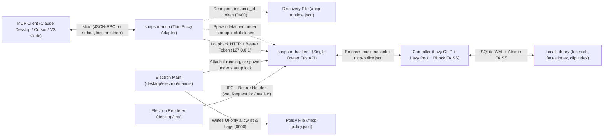

# SnapSort MCP Support — Engineering Design Document

- **Status:** Active Architecture & Implementation Specification
- **Target Product:** Local Model Context Protocol (MCP) integration enabling AI agents (Claude Desktop, Cursor, Claude Code, VS Code) to browse user-approved folders, trigger folder indexing, search photos by person/semantics/folder, and inspect downscaled visual previews—**whether the SnapSort desktop app is open or closed**—with all ML inference and indexing executed 100% offline on-device.

---

## 1. Goals and Non-Goals

### Core Capabilities
- **Client-owned `stdio` MCP adapter (`backend/mcp_server.py`):** Exposes 10 MCP tools over `stdio` without loading ML models or opening database/FAISS files directly.
- **Unified on-demand single-owner backend (`backend/api.py`):** Runs on `127.0.0.1` with a dynamic port, per-launch 256-bit bearer authentication, strict CORS, and an exclusive OS library lock (`backend.lock`).
- **Headless folder processing & search:** When the desktop app is closed and headless access is enabled in Settings, `snapsort-mcp` auto-starts the backend detached (`--headless --idle-timeout 300`), scans approved folders, serves searches and opt-in previews, and auto-exits when idle.
- **Seamless desktop attach/detach:** Opening Electron attaches live to an already-running headless backend; closing Electron detaches cleanly without killing an in-progress agent scan.
- **Strict UI-controlled security & privacy:** All capabilities (`mcp_enabled`, `headless_enabled`, `allow_agent_scan`, `allow_previews`, `approved_roots`) default to off/empty in `<data_dir>/mcp-policy.json`, writable only from SnapSort Settings and immutable via MCP.

### Explicit Non-Goals
- **No destructive filesystem operations:** Agents cannot delete, move, or rename original photo files on disk.
- **No cloud sync or telemetry:** All face recognition (YuNet + SFace), CLIP embeddings, SQLite, and FAISS remain strictly local.
- **No LAN or remote network exposure:** Loopback (`127.0.0.1`) only.
- **No arbitrary filesystem scanning:** Agents may only query or scan folders inside user-approved root directories configured in Settings.
- **No autonomous face renaming or merging:** Cluster naming and merging remain user-driven in the SnapSort UI.

---

## 2. System Architecture & Transport Decision

### Selected Transport: `stdio` Thin Proxy → Unified On-Demand Backend Engine (`127.0.0.1:<dynamic-port>`)

The MCP client spawns a lightweight `stdio` adapter (`backend/mcp_server.py`), which translates MCP JSON-RPC tool calls into authenticated loopback HTTP requests against a single-owner FastAPI backend (`backend/api.py`).

### Why Headless Folder Processing Uses a Unified On-Demand Backend Engine

Headless folder processing mutates SQLite (`faces.db`) and in-memory FAISS indexes (`faces.index`, `clip.index`). Two independent processes writing FAISS files to the same `data_dir` will corrupt indexes or drop updates. Making `snapsort-backend` the **single owner per `data_dir`**—started on demand by either Electron OR `snapsort-mcp`—provides four guarantees:

1. **Zero multi-writer FAISS corruption:** Only one `Controller` instance ever reads or writes `faces.db`, `faces.index`, and `clip.index` for a library.
2. **No desktop-vs-headless lock handoff race:** When the user opens SnapSort during an agent scan, Electron attaches to the running backend and renders live scan progress instead of fighting over file locks.
3. **Single ML memory footprint:** Multiple concurrent MCP clients share one backend process rather than each loading duplicate CLIP/YuNet/SFace ONNX models and worker pools.
4. **Identical policy & indexing behavior:** Both desktop-initiated and headless scans enforce the same `mcp-policy.json` allowlist, symlink checks, and atomic saves.



### Why `stdio` Proxy Wins Over Alternatives

| Transport Option | Assessment | Decision |
| --- | --- | --- |
| **`stdio` Thin Proxy → Single-Owner Backend (Selected)** | Works seamlessly with Electron's dynamic `getFreePort()`, supported by every major local MCP client without TLS/OAuth, keeps one live owner of models/DB/FAISS, and supports headless folder scans safely with zero config changes. | **Use** |
| **Streamable HTTP on FastAPI** | Removes the adapter script, but breaks static MCP client configs whenever Electron picks a new random port, exposes local HTTP surfaces to browser/CSRF risks, and cannot auto-start the backend when SnapSort is closed. | Defer (only if remote/browser MCP clients are ever needed) |
| **Legacy HTTP + SSE** | Deprecated in the MCP specification in favor of Streamable HTTP; carries all HTTP drawbacks plus persistent connection overhead. | Reject |
| **Direct-Disk `stdio` (No Backend Engine)** | Loads duplicate CLIP/ONNX weights into every MCP client process (hundreds of MB RAM per client) and causes concurrent SQLite/FAISS corruption during headless folder writes or when Electron opens. | Reject |

### Why Stale Reads Do Not Occur
`snapsort-mcp` **never** opens `faces.db`, `faces.index`, or `clip.index` from disk. Every query goes over loopback HTTP to `snapsort-backend`'s single live `Controller` (`backend/controller.py`), which owns both the active SQLite connection and the in-memory FAISS indexes (`self.idx`, `self.clip_index`). Whenever a desktop or headless scan indexes a photo, renames a person, or merges clusters, `Controller` updates those live structures immediately—so subsequent MCP calls see fresh results even before periodic disk flushes complete.

---

## 3. Process Lifecycle & Discovery Protocol

### Ownership Rule
- **The AI client owns the `snapsort-mcp` (`stdio`) process.** SnapSort never spawns or kills `snapsort-mcp`.
- **`snapsort-backend` is a shared single-owner local service per `data_dir`**, started on demand by whichever client (Electron or `snapsort-mcp`) arrives first and shut down cleanly when no desktop session, active scan, or recent MCP lease remains.

### End-to-End Lifecycle
1. **AI client launches `snapsort-mcp`:** The adapter loads zero ML models, opens no DB/FAISS files, and keeps `stdin`/`stdout` open for JSON-RPC (`stderr` only for diagnostics).
2. **Startup coordination (`startup.lock` + `backend.lock`):**
   - Before spawning a backend, both Electron and `snapsort-mcp` acquire a short-lived OS lock `<data_dir>/startup.lock`, re-check `mcp-runtime.json` and `GET /api/status`, and only spawn if no live compatible instance is running.
   - Inside `snapsort-backend`, startup immediately acquires an exclusive `<data_dir>/backend.lock` (`fcntl.flock` / `msvcrt`) before opening SQLite or FAISS so two engines can never open the same library.
3. **When SnapSort desktop is closed:**
   - **If `mcp_enabled` is `false`:** `snapsort-mcp` returns an actionable error (`"SnapSort MCP access is disabled in Settings"`) without spawning.
   - **If `headless_enabled` is `false`:** `snapsort-mcp` stays alive at 0% CPU and returns `"Open SnapSort to search this library"` without crashing.
   - **If `mcp_enabled` and `headless_enabled` are `true` in `mcp-policy.json`:** `snapsort-mcp` spawns `snapsort-backend --headless --idle-timeout 300 --data-dir ... --models-dir ...` as a **detached** OS process (`start_new_session=True` on POSIX; `DETACHED_PROCESS | CREATE_NEW_PROCESS_GROUP` on Windows) with `stdin=DEVNULL`, `stdout=DEVNULL`, and `stderr` redirected to `<data_dir>/backend.log` so the backend **never inherits the MCP `stdio` pipe**.
4. **Backend readiness & discovery file (`<data_dir>/mcp-runtime.json`):**
   - The spawner allocates a free loopback port, generates `instance_id` and a 256-bit `token` (`secrets.token_urlsafe(32)`), and passes the token via environment variable `SNAPSORT_API_TOKEN` (never CLI `argv`).
   - Once `backend.lock` is held and `Controller` is initialized, `snapsort-backend` writes `<data_dir>/mcp-runtime.json` atomically (`tmp` + `0600` + `fsync` + `os.replace`):
   ```json
   {
     "version": 1,
     "mode": "desktop",
     "app_version": "3.1.0",
     "protocol_version": 1,
     "port": 54321,
     "instance_id": "8f3c2d9a-...",
     "token": "<256-bit-secret>",
     "data_dir": "/resolved/realpath/to/data",
     "pid": 12345,
     "started_at": "2026-11-24T13:30:00Z"
   }
   ```
   *(When `mcp_enabled` is `false` in desktop mode, `mcp-runtime.json` is omitted or deleted.)*
5. **Adapter verification & reconnect:** Before forwarding a tool call, `snapsort-mcp` queries `GET /api/status` (authenticated) and verifies `instance_id` and resolved `data_dir`. On connection failure, `401`, or `instance_id`/`data_dir` mismatch, it re-reads `mcp-runtime.json` and retries once (or auto-starts the headless backend if enabled).
6. **Electron attaches to a running headless backend:**
   - On launch, Electron acquires `startup.lock` and checks `mcp-runtime.json` + `/api/status`.
   - If a live backend for the same `data_dir` and `app_version` is running, Electron calls `POST /api/client/attach` (registering `desktop_pid` and starting a periodic heartbeat), transitions `"mode"` to `"desktop"`, and shows any active agent scan live in the UI.
   - If `app_version` differs (e.g., after an app upgrade), Electron calls `POST /api/shutdown` (which saves FAISS cleanly and exits) and spawns the new version.
7. **Electron closes / detaches cleanly:**
   - Instead of blindly sending `SIGINT`, Electron calls `POST /api/client/detach`.
   - If `active_scans == 0` and no recent headless MCP lease exists, `snapsort-backend` saves FAISS indexes, deletes `mcp-runtime.json` via compare-and-delete (`instance_id` match), and exits immediately.
   - If an agent scan is still running, `snapsort-backend` switches to `"headless"` mode, finishes and checkpoints the scan, and auto-exits after `idle_timeout`.
   - Both FastAPI shutdown (`lifespan`) and Electron (`pythonProcess.on('close')` in `desktop/electron/main.ts`) enforce compare-and-delete on `mcp-runtime.json`.
   - **Critical rule:** `snapsort-mcp` **must stay alive** if the backend exits when headless mode is disabled; an unexpected EOF on `stdio` causes most MCP clients to mark the server crashed until restarted.
8. **Orphan protection & AI client exit:**
   - `snapsort-backend` monitors `desktop_pid` liveness (clearing `desktop_attached` if Electron crashed) and auto-exits cleanly once `desktop_attached == False`, `active_scans == 0`, and `idle_timeout` (default 300s) has elapsed since the last authenticated request.
   - When the AI client closes, `stdin` hits EOF and `snapsort-mcp` exits cleanly with code `0`.

---

## 4. MCP Tool Surface & Search Semantics

All 10 MCP tools operate identically whether the desktop app is open or closed, governed strictly by `<data_dir>/mcp-policy.json`.

### Capability Discovery (`initialize.instructions` & Tool Annotations)
- **`initialize.instructions`:** `backend/mcp_server.py` returns concise workflow instructions during `initialize` so connected AI agents know to resolve person names via `list_people` first, use `get_person_images` for person-only lookups, use `search_images` for scene + person filtering, check `list_approved_folders`, and poll `get_scan_progress` on larger scans.
- **MCP Tool Annotations:** Every tool in `TOOLS_SCHEMA` declares `readOnlyHint`, `destructiveHint`, `idempotentHint`, and `openWorldHint` (`readOnlyHint: true` on all 9 read/search/preview tools; `readOnlyHint: false, destructiveHint: false` on `scan_folder`).

| Tool | Inputs | Behavior & Return Shape |
| --- | --- | --- |
| `list_people` | `name_filter?`, `limit=20`, `offset=0` | Returns face cluster IDs, nullable names, and **distinct photo counts** (`COUNT(DISTINCT o.image_id)`). Preserves separate IDs when multiple clusters share the same name. Cap `limit <= 100`. |
| `get_person_images` | `person_id`, `folder?`, `limit=20`, `offset=0` | Returns a stably ordered (`ORDER BY`) page of distinct indexed image paths containing `person_id` (optionally scoped to canonical `folder` prefix). Includes photos without CLIP embeddings. Distinguishes unknown `person_id` (`404`) from an empty page and resolves merged cluster redirects. |
| `search_images` | `query`, `person_id?`, `folder?`, `top_k=20` | Semantic search (`top_k <= 100`). When `person_id` or `folder` is provided, **pre-filters** the candidate set **before** FAISS ranking (`CLIPIndex.search_subset`). Returns `{results: [{path, score}], indexing_in_progress, active_scan_id}`. |
| `get_image_faces` | `path` | Validates `path` is indexed; returns cluster IDs and nullable names for that photo. Distinguishes an unindexed path (`404` error) from an indexed photo with zero detected faces (`faces: []`). |
| `get_library_stats` | None | Returns total photo count, face cluster count, distinct assigned-name count, and active scan status (`indexing_in_progress`, `active_scan_id`). |
| `list_approved_folders` | None | Lists user-approved library root folders from `mcp-policy.json`, indexed counts per root, and active scan state. |
| `list_folder_images` | `folder`, `limit=20`, `offset=0` | Validates `folder` is within an approved root; returns stably paginated indexed paths under that folder (trailing-separator canonical prefix match). |
| `scan_folder` | `folder`, `wait_seconds=0` | Requires `allow_agent_scan: true`. Canonicalizes `folder` via `os.path.realpath()` and verifies it sits inside an approved root. Enqueues a serialized scan job (or attaches to an existing queued/running job for the same path). Optionally waits up to `min(wait_seconds, 30)` seconds for small folders. Returns `{scan_id, status, total_images, new_images, processed_images}`. |
| `get_scan_progress` | `scan_id?` | Returns current/specific job status (`queued`, `walking`, `indexing`, `completed`, `failed`), counts, and per-job errors. |
| `get_image_preview` | `path`, `max_size=1024` | **Opt-in only (`allow_previews: true`).** Validates `path` via `_resolve_indexed_path()` and approved-root check (when roots are configured), downscales to `min(max_size, 1024)` JPEG with EXIF/GPS stripped, enforces per-minute rate limit, and returns an MCP image content block. |

### Query Resolution Rules
- **Person + context** (e.g., *"Priya at the beach"*): Resolve `"Priya"` via `list_people`. If multiple clusters match, ask the user to disambiguate. If none match, report that the person is not in the indexed People view. Then call `search_images(query="beach", person_id=id, top_k=20)`.
- **Person-only** (e.g., *"show me Priya"*): Call `get_person_images(person_id=id)` so photos lacking CLIP embeddings are still returned.
- **Visual description only** (e.g., *"someone in a red jacket"*): Call `search_images(query="someone in a red jacket")`.
- **Scan + search** (e.g., *"scan my Goa folder and find sunset photos"*): Verify `"Goa"` via `list_approved_folders`, call `scan_folder(..., wait_seconds=30)`, poll `get_scan_progress(scan_id)` if still running, then call `search_images(query="sunset", folder=...)`.
- **Long-running headless scans vs. MCP client timeouts (30–60s):** Never block an MCP tool call indefinitely while scanning thousands of photos. `scan_folder` returns immediately (or after bounded `wait_seconds <= 30`) with `scan_id`, and agents poll `get_scan_progress(scan_id)` (with optional `notifications/progress` emitted if the client supplies a progress token).
- **Shared backend normalization:** `GET /api/search` and `Controller` in `backend/api.py` and `backend/controller.py` support optional `person_id`, `folder`, `limit`, and `include_meta` while preserving existing UI caller behavior.

---

## 5. Race Conditions, Concurrency Hazards, and Failure Modes

| # | Hazard / Trigger | Verified Codebase Location | Concrete Mitigation |
| --- | --- | --- | --- |
| **1** | **Concurrent FAISS mutation vs. search/save (crash or memory corruption):** `Pool` callback runs on a worker callback thread where `asyncio.get_running_loop()` raises `RuntimeError`, causing `_process_result()` to mutate `self.idx` and `self.clip_index` concurrently with `GET /api/search`. FAISS C++ indexes are not thread-safe. | `backend/controller.py` (`_handle_image_result`, `_process_result`), `backend/search_engine.py` (`search`), `backend/clip_index.py`, `backend/indexer.py` | Add a `threading.RLock` inside both `CLIPIndex` and `FaissIndex` guarding `add`, `find_or_add`, `search`, `search_subset`, `save`, and `ntotal`. Offload `search_engine.search()` (CLIP ONNX + FAISS) to `asyncio.to_thread()` so searches never block FastAPI's event loop. |
| **2** | **Non-atomic FAISS saves & lost tail updates:** `faiss.write_index()` overwrites files in place (crash mid-write corrupts the index). `Controller` saves only every 50 images—never on scan completion or shutdown—causing SQLite `clip_status` and FAISS files to diverge. | `backend/indexer.py` (`FaissIndex.save`), `backend/clip_index.py` (`CLIPIndex.save`), `backend/controller.py` (`_process_result` `% 50` block) | Write to `<path>.tmp.<pid>.<tid>`, `fsync`, and swap atomically via `os.replace()`. Force index save when a scan job finishes (`pending_tasks == 0` and queue empty) and during FastAPI `lifespan` shutdown. Run startup reconciliation (`reconcile_clip_status`) between SQLite `clip_status` and `clip.index`. |
| **3** | **Concurrent UI + Agent scans & 0-new-images deadlock:** `scan_folder()` has no lock, runs blocking `os.walk()` on the event loop, and when `len(new_images) == 0`, `_submit_next_images()` dispatches nothing—leaving `self.is_scanning = True` permanently. | `backend/controller.py` (`scan_folder`, `_submit_next_images`) | Guard scan state with `self.scan_lock`. Complete immediately when `len(new_images) == 0`. Move `os.walk()` off the event loop (`asyncio.to_thread`). Maintain a serialized **scan job queue** (`scan_id`, deduplicating identical queued paths) so UI and agent scans queue cleanly. |
| **4** | **Search-while-scanning partial results:** Agent calls `scan_folder()` and immediately calls `search_images()` before workers finish, misreporting partial hits as complete. | `backend/api.py` (`/api/search`), `backend/controller.py` | Include `indexing_in_progress` and `active_scan_id` in `search_images` and `get_library_stats` responses; provide `get_scan_progress` and bounded `wait_seconds` (max 30s) on `scan_folder`. |
| **5** | **Dual SnapSort instances corrupting the same library:** Two desktop or headless processes opening the same `data_dir` overwrite SQLite and FAISS files. | `backend/api.py`, `backend/db.py`, `backend/controller.py` | Acquire an exclusive OS file lock (`<data_dir>/backend.lock` via `fcntl.flock` / `msvcrt`) on backend startup before opening SQLite/FAISS. Enable SQLite WAL mode (`PRAGMA journal_mode=WAL`, `busy_timeout=5000`). |
| **6** | **Discovery file races & Windows exit cleanup:** `stopPythonBackend()` sends `SIGINT`, which skips Python shutdown handlers on Windows; a slow exiting process can also delete a newer instance's discovery file. | `desktop/electron/main.ts` (`stopPythonBackend`, `pythonProcess.on('close')`) | Atomic temp+rename writes for `mcp-runtime.json`; compare-and-delete on `instance_id` in both FastAPI `lifespan` shutdown and Electron `pythonProcess.on('close')`; adapter verifies `instance_id` + `data_dir` via `/api/status` and retries discovery once. |
| **7** | **Face cluster ID drift & FAISS resurrection after merge:** Merging cluster `7` into `3` deletes row `7` in SQLite but leaves vector `7` in `faces.index`. Future scans matching vector `7` recreate an orphaned cluster, and agents holding `person_id=7` get stale failures. | `backend/db.py` (`merge_faces`), `backend/indexer.py` (`find_or_add`) | Persist a `face_merges(old_id PRIMARY KEY, primary_id)` redirect table in SQLite. Resolve redirects during both scanning (preventing resurrection) and `get_person_images`/`search_images`. |
| **8** | **Filesystem drift, unmounted drives, & symlink escapes:** Photos deleted, moved, edited (`mtime` changed), or unmounted after indexing; symlinks inside an approved folder pointing outside it. | `backend/controller.py` (`scan_folder`), `backend/api.py` (`_resolve_indexed_path`) | Canonicalize approved roots with `os.path.realpath()` and reject any file whose `realpath` escapes all approved roots. Track `mtime` to re-index edited images and fail fast if an approved root is unmounted without deleting indexed DB rows. Enforce `_resolve_indexed_path()` on every media/preview route. |
| **9** | **Headless vs. Desktop startup race ("thundering herd") & version skew:** Two MCP clients or Electron + MCP starting simultaneously when no backend is running, or Electron upgrading while an older headless backend is alive. | `backend/mcp_server.py`, `desktop/electron/main.ts`, `backend/api.py` | Serialize spawn attempts via `<data_dir>/startup.lock` + re-check before spawn; enforce exclusive `<data_dir>/backend.lock` inside `snapsort-backend`; include `app_version` in `mcp-runtime.json` and `/api/status` so Electron triggers `POST /api/shutdown` before launching a newer version. |
| **10** | **Desktop closing mid-agent-scan & orphan headless backends:** Electron's `stopPythonBackend()` (`SIGINT`) killing an in-progress headless scan, or a detached headless backend lingering forever after an AI client crashes. | `desktop/electron/main.ts` (`stopPythonBackend`), `backend/api.py` | Replace blind `SIGINT` with `POST /api/client/detach` (exit immediately when idle; otherwise finish active scan in headless mode and flush FAISS); check `desktop_pid` liveness; enforce `--idle-timeout 300` auto-exit when `desktop_attached == False` and `active_scans == 0`. |
| **11** | **Spawned backend inheriting MCP `stdio` pipes:** If `snapsort-mcp` spawns `snapsort-backend` without redirecting `stdin`/`stdout`/`stderr`, uvicorn/Python logs corrupt MCP JSON-RPC frames and hold pipes open. | `backend/mcp_server.py` | Always spawn `snapsort-backend` detached (`start_new_session=True` / `DETACHED_PROCESS | CREATE_NEW_PROCESS_GROUP`) with `stdin=DEVNULL`, `stdout=DEVNULL`, and `stderr` redirected to `<data_dir>/backend.log`. |
| **12** | **Headless CPU/RAM/battery exhaustion & unattended scan failures:** Eagerly spawning 4 ML worker processes consumes 1–2+ GB RAM and spikes CPU/fans on battery; corrupt images or unplugged drives could stall unattended jobs. | `backend/controller.py`, `backend/worker.py` | Load `CLIPProcessor` lazily on first semantic search and spawn `multiprocessing.Pool` lazily only during active scans (tearing down after 60s idle). Cap headless workers (`max(1, min(2, cpu_count // 2))`) with low OS priority (`os.nice(10)` / `BELOW_NORMAL_PRIORITY_CLASS`), enforce `max_headless_scan_images`, and isolate worker errors. |
| **13** | **MCP `stdio` corruption & context/memory exhaustion:** Any `print()` or library stdout log breaks JSON-RPC; unbounded queries or full-resolution images blow up agent context. | `backend/mcp_server.py`, `backend/api.py` | Route all adapter logs strictly to `stderr`. Cap `limit`/`top_k` at 100. Cap `get_image_preview` at `max_size <= 1024`, strip EXIF/GPS by JPEG re-encode, and rate-limit preview calls. |

---

## 6. Security & Privacy Architecture

### Threat Model
- **Malicious local browser tabs:** Cross-origin requests, CSRF, or DNS rebinding targeting `http://127.0.0.1:<port>`.
- **Other OS users on shared machines:** Reading local ports, discovery files, or library metadata.
- **Prompt-injected AI agents:** Attempting to read arbitrary files outside the photo library, exfiltrate raw EXIF/GPS data, or index sensitive system/home directories—even when the desktop app is closed.
- **Cloud-backed MCP clients:** Sending tool outputs (local paths, person names, and previews if enabled) to remote LLM providers.

### Required Security Controls
1. **Loopback-only binding & DNS-rebinding defense:** Keep `host="127.0.0.1"` (`backend/api.py`) and reject requests with non-loopback `Host` headers (`403 Forbidden`).
2. **Per-launch bearer token authentication:**
   - Generate a 256-bit secret (`secrets.token_urlsafe(32)`) per launch. Pass it to `snapsort-backend` via `SNAPSORT_API_TOKEN` environment variable (never CLI `argv`).
   - Require `Authorization: Bearer <token>` on every `/api/*` and `/media/*` endpoint (`401 Unauthorized` otherwise).
   - Pass the token to Electron renderer via IPC (`preload.ts`) for `axios` (`desktop/src/api.ts`), and inject `Authorization: Bearer <token>` on `http://127.0.0.1:<port>/*` requests via `session.defaultSession.webRequest.onBeforeSendHeaders` in `desktop/electron/main.ts` (avoiding tokens in `` query URLs).
   - Write the token to `<data_dir>/mcp-runtime.json` with strict owner-only permissions (`0600` POSIX / current-user ACL Windows).
3. **Strict CORS:** Replace `allow_origins=["*"]` (`backend/api.py`) with strict loopback origin regex (`^https?://(localhost|127\.0\.0\.1)(:\d+)?$`) and `allow_credentials=False`.
4. **UI-written, MCP-immutable policy store (`<data_dir>/mcp-policy.json`):**
   - Electron Settings (using native OS folder picker `dialog.showOpenDialog`) writes `mcp_enabled`, `headless_enabled`, `allow_agent_scan`, `allow_previews`, `max_headless_scan_images`, and canonical `approved_roots` atomically to `<data_dir>/mcp-policy.json` (`0600` POSIX / user-only ACL Windows).
   - `snapsort-backend` re-reads and enforces `mcp-policy.json` on every MCP request. MCP exposes **zero** tools or HTTP routes to modify policy or add approved folders.
5. **Granular opt-in gates in Settings (all off by default):**
   - **Enable MCP Access** (`mcp_enabled` — off by default).
   - **Allow Headless Background Access** (`headless_enabled` — off by default; prevents agents from launching `snapsort-backend` when the desktop app is closed).
   - **Allow Visual Previews (`get_image_preview`)** (`allow_previews` — off by default; downscaled EXIF-stripped JPEG only).
   - **Allow Agent Folder Scanning (`scan_folder`)** (`allow_agent_scan` — off by default; restricted strictly to `approved_roots`).
6. **Cloud privacy disclosure:** Show a clear warning in Settings before enabling MCP or copying client config explaining that while SnapSort processes everything locally, cloud-backed MCP clients transmit returned file paths, person names, and (if enabled) previews to their AI provider.
7. **Mandatory indexed-path validation:** Keep `_resolve_indexed_path()` (`backend/api.py`) on every media/preview endpoint, and enforce it on `GET /api/images/faces`.
8. **Offline audit log & instant kill switch:** Log all MCP tool calls to a rotated local `<data_dir>/mcp-audit.log` (timestamp, tool name, folder/query summary, status—never bearer tokens or image bytes). Provide a Settings activity view and a **"Stop Headless Backend & Revoke Token"** action.

---

## 7. Packaging, Distribution & Client Configuration

### Development Configuration
```json
{
  "mcpServers": {
    "snapsort": {
      "command": "uv",
      "args": [
        "--directory", "/path/to/SnapSort",
        "run", "python", "backend/mcp_server.py",
        "--data-dir", "/path/to/SnapSort/data",
        "--models-dir", "/path/to/SnapSort/models"
      ]
    }
  }
}
```
*(In development, `--models-dir` defaults to the repository `models/` directory when omitted.)*

### Packaged Installation
- Packaged desktop users must be able to launch `snapsort-mcp`—and auto-start `snapsort-backend --headless`—without installing Python, `uv`, or a source checkout.
- **Entry point & binary resolution:**
  - Ship either a lightweight standalone adapter binary alongside `api`/`api.exe`, or a `--mcp` subcommand on the packaged executable that branches **before** importing FastAPI, ONNX Runtime, FAISS, or `Controller`.
  - Pass explicit `--backend-bin`, `--models-dir`, and `--data-dir` arguments generated by **Settings → MCP & AI Agent Access**.
- **Quick Connect AI Clients & Manual JSON:**
  - **Quick Connect:** Auto-detects `Claude Desktop`, `Cursor`, `Claude Code`, and `VS Code`, backs up existing configs to `<config>.snapsort.bak`, and merges only `snapsort` atomically (`0600` on POSIX) with one-click Connect, Update, and Disconnect actions.
  - **Manual JSON Copy:** Generates and copies the exact client configuration with absolute paths to the adapter, backend binary, models directory, and active `data_dir`.

---

## 8. Verified Codebase Baseline & Implementation Targets

1. **Distinct photo count & pagination (`backend/db.py`):** `get_all_faces_with_counts()` must use `COUNT(DISTINCT o.image_id)` and support `name_filter`, `limit`, and `offset`.
2. **Stable pagination & existence check (`backend/db.py`):** `get_images_with_face()` must apply `ORDER BY images.id`, optional `folder`, `LIMIT`, `OFFSET`, and distinguish unknown `face_id`.
3. **Unindexed path handling (`backend/api.py`):** `GET /api/images/faces` must return `404` for unindexed paths instead of `{"faces": []}`.
4. **Windows cleanup (`desktop/electron/main.ts`):** Compare-and-delete `mcp-runtime.json` on `pythonProcess.on('close')` and FastAPI shutdown.
5. **Library identity (`backend/api.py`, `backend/mcp_runtime.py`):** Include resolved `data_dir`, `instance_id`, `mode`, and `app_version` in `mcp-runtime.json` and `GET /api/status`.
6. **Auth & CORS (`backend/api.py`, `desktop/electron/main.ts`):** Replace `allow_origins=["*"]`, enforce `Host` + bearer token on `/api/*` and `/media/*`, and inject auth headers for Electron media via `webRequest.onBeforeSendHeaders`.
7. **Thread-safe & atomic FAISS (`backend/indexer.py`, `backend/clip_index.py`):** Guard FAISS operations with `threading.RLock`, use temp+`fsync`+`os.replace()`, and run `search_engine.search()` in `asyncio.to_thread()`.
8. **Scan queue, 0-new-images fix, & end-of-scan save (`backend/controller.py`):** Serialize scan jobs under `scan_lock`, reset state immediately on `0` new images, save FAISS on job completion and shutdown, and reconcile `clip_status` on startup.
9. **Face-merge redirect tracking (`backend/db.py`, `backend/controller.py`):** Persist `face_merges` redirects and resolve merged IDs during scans and queries.
10. **Lazy CLIP & lazy throttled Pool (`backend/controller.py`, `backend/worker.py`):** Load `CLIPProcessor` and `multiprocessing.Pool` lazily, tear down idle pools, and run headless workers at lower count and priority.
11. **Attach/detach lifecycle (`desktop/electron/main.ts`, `backend/api.py`):** Attach to an existing compatible backend on startup and detach via `POST /api/client/detach` on exit without interrupting active headless scans.

---

## 9. Acceptance Checks

- **Search accuracy & disambiguation:** Place a relevant photo outside the global CLIP top-K shortlist; `search_images` with `person_id` still finds it. Duplicate names trigger disambiguation. `get_person_images` includes photos without CLIP embeddings and paginates without duplicates.
- **Auth & CORS hardening:** Unauthenticated requests or cross-origin/non-loopback browser requests to `/api/*` and `/media/*` return `401`/`403`; Electron UI images render cleanly via `webRequest.onBeforeSendHeaders`.
- **Concurrency & persistence:** Concurrent `search_images` calls during an active multi-worker scan succeed without crashing, report `indexing_in_progress: true`, and include newly indexed images immediately. Scanning a folder with `0` new images completes cleanly. Restarting mid-scan or after `<50` images leaves valid FAISS files matching SQLite `clip_status`.
- **Headless scan, search & previews:** With Electron closed and `mcp_enabled`, `headless_enabled`, `allow_agent_scan`, and `allow_previews` enabled in `mcp-policy.json`, `snapsort-mcp` auto-spawns `snapsort-backend --headless`, scans an approved folder, polls `get_scan_progress`, searches newly indexed images, returns EXIF-stripped JPEG previews, logs to `mcp-audit.log`, and exits cleanly after idle timeout with zero `stdout` corruption.
- **Attach/detach, thundering herd & policy safety:** Two MCP clients starting simultaneously spawn only one backend. Opening Electron mid-headless-scan attaches live; closing Electron mid-headless-scan lets the scan finish and save FAISS before exiting. Unapproved paths, outward symlinks, and disabled policy flags are rejected cleanly.

---

## 10. Running the Automated Test Suite

All MCP unit, race-condition, security, and stress tests live in `backend/tests/` and `desktop/tests/` using isolated temporary directories:

```bash
# Fast suite: E2E + security + race conditions
.venv/bin/python scripts/run_mcp_tests.py --fast

# Full Python suite (adds 63-image batch, 4-client burst, corrupt files, idle auto-shutdown)
.venv/bin/python scripts/run_mcp_tests.py --stress

# Complete verification (Python suites + desktop mcpClients tests + tsc + oxlint)
.venv/bin/python scripts/run_mcp_tests.py --all
```
